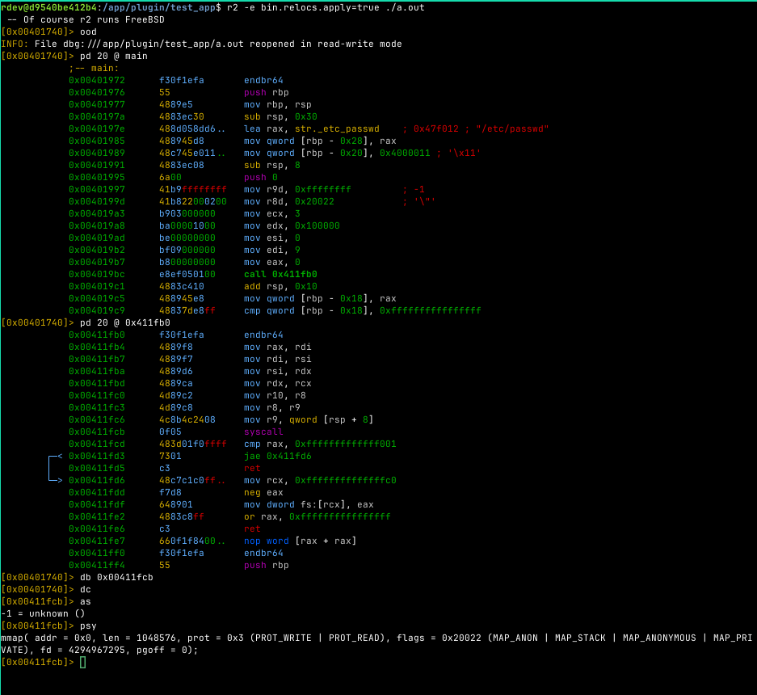

# SysReader: A Radare2 Syscall & Flag Parsing Plugin

When reverse engineering Linux malware or stripped binaries, understanding what a system call is doing at a glance can be tedious. SysReader is an offline, air-gapped Radare2 plugin designed to dynamically inspect system calls right before execution, resolving register arguments, dereferencing memory pointers, and decoding complex bitwise flags and signals into human-readable C-style comments.



---

## Key Features

* **Multi-Architecture & Multi-Bitness Support**: Automatically detects target architecture and calling conventions via radare2 (`asm.arch` and `asm.bits`):
  * **x86_64**: Syscall opcode `syscall`, syscall number in `rax`, arguments in `rdi`, `rsi`, `rdx`, `r10`, `r8`, `r9`.
  * **x86 (32-bit i386)**: Syscall opcode `int 0x80`, syscall number in `eax`, arguments in `ebx`, `ecx`, `edx`, `esi`, `edi`, `ebp`.
  * **ARM64 (AArch64)**: Syscall opcode `svc #0`, syscall number in `x8`, arguments in `x0`, `x1`, `x2`, `x3`, `x4`, `x5`.
  * **ARM (32-bit EABI)**: Syscall opcode `svc 0` / `swi 0`, syscall number in `r7`, arguments in `r0`, `r1`, `r2`, `r3`, `r4`, `r5`.
* **Bitwise Flag & Signal Decomposition**:
  * Deconstructs compound flag masks into constituent definitions (e.g. `O_RDWR | O_CREAT | O_CLOEXEC`).
  * Distinguishes discrete signal values from bitwise flags in syscalls like `clone` (e.g., separating low 8-bit `SIGCHLD` from upper `CLONE_*` namespace flags).
* **Inline Flag Explanations**: Embeds human-readable descriptions directly within the output in standard C comment syntax (`/* ... */`).
* **Memory & String Previews**: Automatically dereferences pointer arguments and string paths (e.g. `"/etc/passwd" @ 0x...`).
* **Radare2 Comment Integration (`psyc`)**: Directly annotates radare2 assembly disassembly with the resolved syscall expression.

---

## Why Not Just Use eBPF or strace?

While `strace` and `eBPF` are powerful dynamic analysis tools, they are reliant on the program actually making the call. When analyzing evasive binaries, anti-debugging mechanisms, or dangerous malware in a controlled sandbox, an analyst often needs to know **what the call is going to do before it is executed**. SysReader operates directly inside your interactive radare2 session, without requiring network access, external services, or local LLMs.

---

## Commands & Usage

SysReader registers the `ps` command prefix in radare2:

| Command | Description |
| :--- | :--- |
| `psy` | Decodes the syscall at the current instruction pointer (`PC`) and prints the call, parameters, and flag explanations to the console. |
| `psyc` | Decodes the syscall, prints the output, **and** writes the complete expression as a radare2 comment at the current address. |
| `ps?` / `psy?` / `psyc?` | Displays plugin command help. |

### Example Session

Breakpoint set at a 32-bit `int 0x80` `clone` syscall:

```text
[0x0804931d]> psy
clone( flags = 0x4000011 (CLONE_NEWUTS /* New UTS namespace (hostname/domain) */ | SIGCHLD /* Child process status changed */), newsp = 0xf7d73000, parent_tidptr = 0x4000011, child_tidptr = 0x804bff4, tls = 0xf7feab60);
```

Using `psyc` to annotate the instruction in radare2 disassembly:

```text
[0x0804931d]> psyc
clone( flags = 0x4000011 (CLONE_NEWUTS /* New UTS namespace (hostname/domain) */ | SIGCHLD /* Child process status changed */), newsp = 0xf7d73000, parent_tidptr = 0x4000011, child_tidptr = 0x804bff4, tls = 0xf7feab60);
Added comment at 0x0804931d

[0x0804931d]> pd 1
; clone( flags = 0x4000011 (CLONE_NEWUTS /* New UTS namespace (hostnam
; e/domain) */ | SIGCHLD /* Child process status changed */), newsp = 0x
; f7d73000, parent_tidptr = 0x4000011, child_tidptr = 0x804bff4, tls = 0
; xf7feab60);
            0x0804931d b    cd80           int 0x80
```

---

## Syscall Database & The Parser (`parser_core/` & `parser.py`)

SysReader relies on an offline JSON database (`data/syscalls.json`) that maps Linux syscall numbers, argument schemas, bitwise flags, and signals.

### Architecture of the Parser Package

The parser is structured into a modular Python package located in [`parser_core/`](parser_core/) with a lightweight CLI entrypoint in [`parser.py`](parser.py):

* **[`parser.py`](parser.py)**: CLI wrapper providing argument parsing (`--output`, `--extra-headers`, `--test-only`).
* **[`parser_core/config.py`](parser_core/config.py)**: Defines default system headers (`DEFAULT_HEADERS`), preprocessor noise blacklists (`MACRO_BLACKLIST`), and canonical flag name mappings (`PREFERRED_NAMES`).
* **[`parser_core/routing.py`](parser_core/routing.py)**: Flag prefix routing table (`PREFIX_ROUTING`) mapping syscall arguments and struct fields to relevant macro prefixes.
* **[`parser_core/schemas.py`](parser_core/schemas.py)**: Base syscall signatures and argument schemas for 83+ Linux syscalls, plus fallback structs (`clone_args`, `open_how`).
* **[`parser_core/evaluator.py`](parser_core/evaluator.py)**: GCC preprocessor scanning (`gcc -dM -E` with multiarch fallback), struct extraction, and batch C compiler constant evaluation.
* **[`parser_core/builder.py`](parser_core/builder.py)**: Orchestrates header scanning, constant evaluation, flag filtering, and JSON serialization.

### How Macro Parsing & Constant Resolution Works

1. **Preprocessor Extraction**: Runs `gcc -dM -E` across host headers (`<fcntl.h>`, `<sys/mman.h>`, `<linux/sched.h>`, `<sys/mount.h>`, `<sys/wait.h>`, etc.), automatically resolving multiarch header directories.
2. **Iterative Constant & Bitwise Evaluation**: Recursively parses bitwise shifts (`1 << 6`), hexadecimal literals, and aliases.
3. **Fallback C Compiler Evaluation**: For complex multi-tiered macros, expressions are compiled in an ephemeral C translation unit with GCC to extract the exact evaluated integer constants.
4. **Noise Filtering & Canonical Selection**: Filters out compiler-internal definitions and deprecated aliases, keeping clean POSIX and Linux flag names.
5. **Signal Separation**: Identifies discrete exit signals for process creation syscalls (`clone`, `clone3`, `kill`, `tkill`) so they do not collide with bitwise mask calculations.

### Regenerating the Database

To update or regenerate the syscall database against your local system headers:

```bash
# Standard generation
python3 parser.py --output data/syscalls.json

# Include additional custom or kernel headers
python3 parser.py --extra-headers /path/to/custom_header.h --output data/syscalls.json

# Quick schema verification without scanning all system headers
python3 parser.py --test-only
```

---

## Building and Installation

### Prerequisites

* **radare2** (version 5.8+ / 6.x+)
* **gcc** / **clang**
* **make** and **pkg-config**

### Build & Install

```bash
# Build the shared object plugin
make

# Install the plugin and JSON database to ~/.local/share/radare2/plugins/
make install
```

### Uninstall

```bash
make uninstall
```

---

## Development Roadmap

* [x] Expanded Linux kernel syscall flag and signal coverage (80+ syscalls)
* [x] Multi-architecture support (x86_64, x86_32, ARM64, ARM32)
* [x] Inline human-readable comments explaining flags
* [x] Radare2 comment annotation command (`psyc`)
* [ ] Struct dereferencing for modern complex syscalls (`clone3` with `struct clone_args`, `openat2` with `struct open_how`)
* [ ] Cross-OS support (Windows NT syscalls, macOS/Darwin BSD syscalls)
